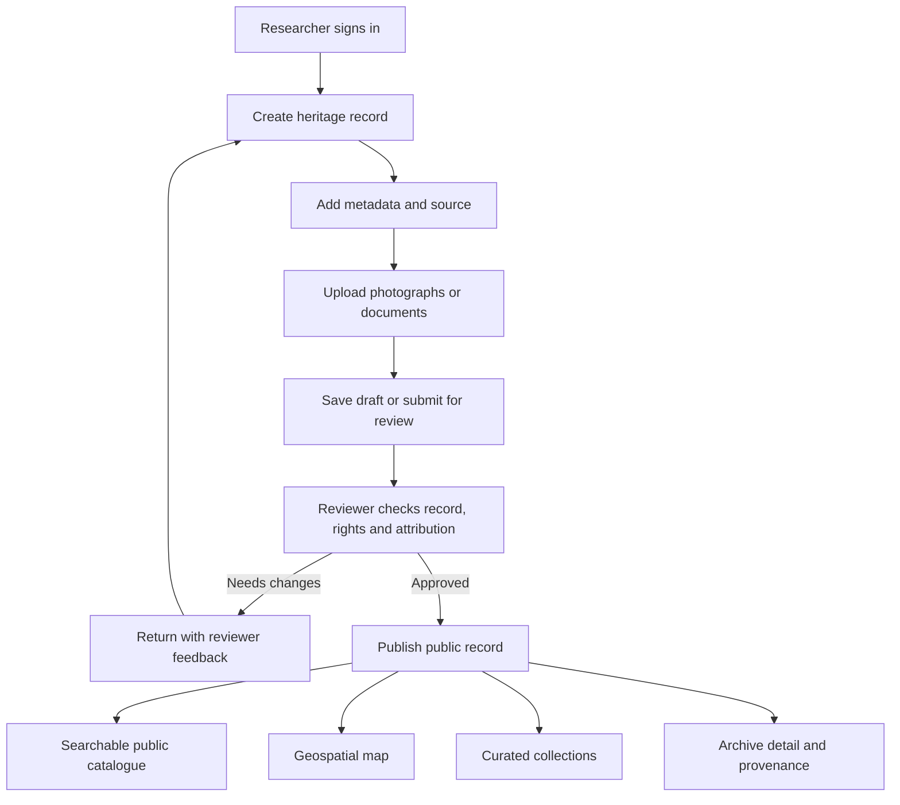
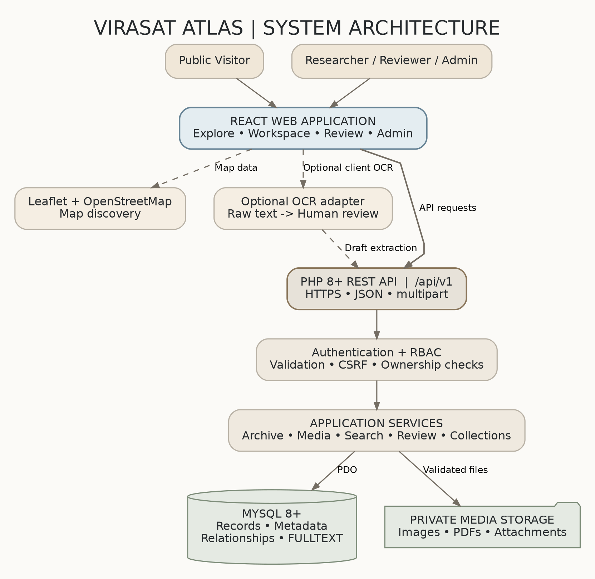
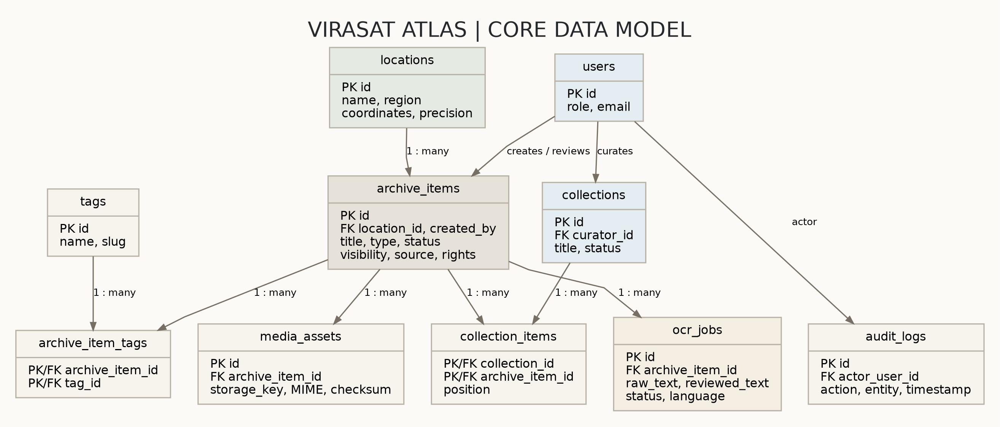

# VIRASAT ATLAS

### From scattered heritage archives to searchable, place-based cultural knowledge.

**A map-first digital heritage archive for preserving, verifying and exploring India's cultural and architectural heritage.**

<p align="left">
  <strong>Challenge:</strong> HC26-CULT01 · Digital Revitalisation of Unstructured Cultural & Architectural Heritage Archives<br>
  <strong>Event:</strong> Blithchron '27 · IIT Gandhinagar<br>
  <strong>Category:</strong> Software · Open Innovation<br>
  <strong>Core stack:</strong> React.js · PHP REST API · MySQL 8+
</p>

**Live prototype:** https://hackcult.gt.tc  
**Source repository:** https://github.com/shahdhairyah/Hackcult_2026_IIT_Gandhinagar_Virasat_Atlas  
**Documentation:** [`docs/`](.)

> Virasat Atlas converts disconnected photographs, historical documents, architectural observations and field notes into structured heritage records. Researchers can contribute and verify records; the public can discover published material through search, maps and curated collections.

---

## Contents

- [1. The problem](#1-the-problem)
- [2. Our solution](#2-our-solution)
- [3. Core capabilities](#3-core-capabilities)
- [4. End-to-end workflow](#4-end-to-end-workflow)
- [5. System architecture](#5-system-architecture)
- [6. Technology stack](#6-technology-stack)
- [7. Repository structure](#7-repository-structure)
- [8. Data model](#8-data-model)
- [9. Local development setup](#9-local-development-setup)
- [10. API reference](#10-api-reference)
- [11. Roles and access model](#11-roles-and-access-model)
- [12. Testing and verification](#12-testing-and-verification)
- [13. Current implementation boundaries](#13-current-implementation-boundaries)
- [14. Security and deployment notes](#14-security-and-deployment-notes)
- [15. Cultural data ethics](#15-cultural-data-ethics)
- [16. Roadmap](#16-roadmap)
- [17. Hackathon demonstration flow](#17-hackathon-demonstration-flow)
- [18. Documentation index](#18-documentation-index)
- [19. Acknowledgements](#19-acknowledgements)

---

## 1. The problem

Cultural and architectural heritage projects generate large amounts of field material: monument photographs, scanned documents, inscriptions, maps, craft documentation, interviews and researcher notes. These materials often remain scattered across presentation decks, local drives and unrelated cloud folders.

When archival material is not consistently described, attributed, verified and connected to its location, it becomes difficult to:

- Find a record without knowing its original filename or folder.
- Understand who documented it, when it was captured and where it came from.
- Compare related sites, architectural features or historical periods.
- Distinguish verified information from an unreviewed transcription or uncertain observation.
- Explore heritage geographically instead of reading disconnected reports.

The challenge is therefore not simply to store files. It is to preserve the **context, provenance, rights and relationships** that make cultural material useful.

## 2. Our solution

Virasat Atlas is a structured archive and public discovery platform built around one connected record model. Each heritage record can carry descriptive metadata, media, location, historical period, language, contributor, source citation, rights and review status.

The platform connects five stages:

1. **Contribute:** a researcher creates a record and uploads supporting media.
2. **Describe:** the researcher supplies place, period, language, source, attribution and rights metadata.
3. **Review:** an authorised reviewer checks the record and its supporting information.
4. **Publish:** approved public records become available in the catalogue and map.
5. **Discover:** visitors explore records through keyword search, filters, map locations and curated collections.

The guiding principle is that a heritage item should be discoverable in more than one way while retaining a single, traceable source record.

## 3. Core capabilities

The repository contains the following application modules and API routes. Feature availability should still be confirmed on the deployed environment before a live demonstration.

| Capability | What it provides | Implementation notes |
|---|---|---|
| Researcher authentication | Sign-in, sign-out and current-user state | PHP session support and role middleware are present. Review the bearer-token limitation in [Security](#14-security-and-deployment-notes). |
| Archive contribution | Create and update heritage records | Metadata validation and draft/submission states. |
| Media management | Upload and view archive attachments | MIME/size checks, generated storage names and SHA-256 metadata are implemented in the PHP layer. |
| Provenance and rights | Record source, creator, attribution and reuse status | Supports accountable archival descriptions. |
| Review and publication | Approve, reject or return submissions for correction | Reviewer workflow with audit events. |
| Public catalogue | Search and browse published records | MySQL FULLTEXT search, filters and pagination. |
| Heritage map | Explore geotagged public records | Leaflet with OpenStreetMap tiles and a list-based fallback. |
| Curated collections | Group records into themes or heritage trails | Ordered collection items and curator notes. |
| Research workspace | View submissions and saved records | Personal saved-item/bookmark endpoints are present. |
| Related records | Surface potentially related heritage entries | Rule-based matching using shared record metadata; not an ML recommendation model. |
| OCR transcription workflow | Store a draft transcription and a reviewed transcript | Current backend OCR generation is **simulated/sample output**, not actual image OCR. See [implementation boundaries](#13-current-implementation-boundaries). |
| Governance dashboard | View record, user, location, collection and storage metrics | API includes database metrics and a fallback response; validate live data before presenting metrics. |
| Audit trail | Record significant user and moderation actions | Audit log endpoint and database table are present. |
| Archive export | Export archive metadata as JSON or CSV | Export feature is present; do not claim formal OAIS/ISO 14721 conformance without an independent standards review. |
| 3D heritage viewer | Interactive conceptual 3D scene with depth/water-level controls | This is a visual exploration prototype, not a 3D reconstruction generated from real photographs. |
| Interface localisation | English, Hindi and Gujarati interface labels | This localises the interface; it does not automatically translate every archival record. |
| Pitch presentation | In-app 10-slide presentation with print/PDF workflow | Available at `/pitch` in the React application. |

## 4. End-to-end workflow



A record should not become public merely because it exists in the database. The PHP API must enforce publication status and visibility on every public read path.

## 5. System architecture

Virasat Atlas uses a **modular monolith**: a React client communicates with a versioned PHP REST API, which applies validation, authorisation and business rules before accessing MySQL or private media storage.

### Architecture diagram



### Database relationship diagram



### Request and data flow

```text
Browser (React + Vite)
        |
        | HTTPS / JSON / multipart form data
        v
PHP REST API (/api/v1)
        |
        +--> Authentication and role checks
        +--> Request validation and application rules
        +--> Repositories using PDO prepared statements
        |          |
        |          v
        |       MySQL 8+
        |
        +--> Private media filesystem
        |
        +--> Audit events and OCR-job records

React map components --> Leaflet --> OpenStreetMap tiles
```

**Architectural boundaries**

- React is responsible for the user interface and interaction; it must never connect directly to MySQL.
- PHP is the authority for identity, permissions, validation, publication visibility, upload processing and audit events.
- MySQL stores structured metadata, relationships and search indexes.
- Original media files are stored outside the public web root; MySQL stores their metadata and storage keys.
- Leaflet renders map interactions in the browser using location data returned by the API.

## 6. Technology stack

| Layer | Technology | Responsibility |
|---|---|---|
| Frontend | React 18 | Component-based user interface |
| Build tooling | Vite 5 | Development server and production build |
| Routing | React Router 6 | Public, researcher, reviewer and admin screens |
| Icons | Lucide React | Interface iconography |
| Backend | PHP 8.2+ | Versioned REST API and application logic |
| Database access | PDO | Parameterised database queries |
| Database | MySQL 8+ / compatible MariaDB | Relational records, constraints and FULLTEXT search |
| Mapping | Leaflet 1.9 + OpenStreetMap | Geospatial discovery |
| Media storage | Private filesystem directory | Original photographs and documents |
| Local frontend/backend proxy | Vite proxy | Routes `/api` requests to the local PHP server |

The core platform does not require a trained AI/ML model. The current OCR controller creates illustrative sample transcription text; it does not run Tesseract or another OCR engine against uploaded image pixels.

## 7. Repository structure

```text
Hackcult_2026_IIT_Gandhinagar_Virasat_Atlas/
├── api/
│   ├── index.php                 # REST API entry point and route dispatch
│   ├── router.php                # PHP built-in server router
│   ├── .env.example              # Backend configuration template
│   ├── src/
│   │   ├── Config/               # Environment and database configuration
│   │   ├── Controllers/          # HTTP endpoint handlers
│   │   ├── Middleware/           # Authentication, roles and CORS
│   │   ├── Repositories/         # PDO data access
│   │   ├── Responses/             # Standard JSON responses
│   │   ├── Services/              # Application services
│   │   └── Validators/            # Input validation
│   └── storage/uploads/           # Private uploaded media (runtime data)
├── client/
│   ├── .env.example              # Frontend API base URL
│   ├── package.json
│   ├── vite.config.js             # Local /api proxy
│   └── src/                       # React application and feature modules
├── database/
│   ├── schema.sql                # Database bootstrap schema
│   └── seed.php                  # Local demonstration data seeder
├── docs/
│   ├── README.md                 # This documentation
│   ├── assets/
│   │   ├── architecture.png
│   │   └── erd.png
│   ├── architectre.md             # System architecture (requested filename)
│   ├── desgin.md                  # UI/UX design (requested filename)
│   ├── prd.md                     # Product requirements
│   ├── phase.md                   # Delivery phases
│   ├── tasks.md                   # Implementation backlog
│   ├── rules.md                   # Engineering and data rules
│   ├── memory.md                  # Project decisions and context
│   └── report.md                  # Full project report, if included in this branch
├── scripts/
│   └── test-all.sh                # Local API/UI integration smoke test
├── README.md                      # Points to docs/README.md
└── .gitignore
```

> Repository layout above is a navigational overview. For exact implementation details, inspect the source files in the current branch.

## 8. Data model

The MySQL schema defines the primary entities below:

| Table | Purpose |
|---|---|
| `users` | User identity, password hash, organisation and role |
| `locations` | Heritage place, region, country and optional coordinates |
| `archive_items` | Main cultural/architectural record, metadata, visibility and review state |
| `media_assets` | File storage key, MIME type, byte size, checksum, alt text and caption |
| `tags` | Controlled descriptive tags |
| `archive_item_tags` | Many-to-many relationship between records and tags |
| `collections` | Curated themes or heritage trails |
| `collection_items` | Ordered records within a collection |
| `ocr_jobs` | Raw transcription, reviewed text, language and review status |
| `audit_logs` | Actor, action, affected entity and timestamp |
| `saved_items` | Researcher bookmarks |

The main archive record includes fields for title, item type, summary, description, location, region, coordinates, capture date, historical period, language, creator, source, rights status, attribution, status and visibility.

`database/schema.sql` includes FULLTEXT indexing for record discovery. Reviewed OCR text is kept separate from raw OCR-job output so unverified text should not be treated as authoritative archival content.

## 9. Local development setup

### 9.1 Prerequisites

Install the following on your development machine:

- Git
- Node.js 20 or later and npm
- PHP 8.2 or later
- PHP extensions: `pdo_mysql` and `fileinfo`
- MySQL 8+ or a compatible MariaDB release
- A terminal with `curl` and `jq` for the integration script

### 9.2 Clone the repository

```bash
git clone https://github.com/shahdhairyah/Hackcult_2026_IIT_Gandhinagar_Virasat_Atlas.git
cd Hackcult_2026_IIT_Gandhinagar_Virasat_Atlas
```

### 9.3 Configure environment files

```bash
cp api/.env.example api/.env
cp client/.env.example client/.env
```

Edit `api/.env` for your local MySQL account and storage directory. Example:

```dotenv
APP_ENV=local
APP_DEBUG=true
APP_URL=http://127.0.0.1:8000
APP_ALLOWED_ORIGIN=http://localhost:5173
DB_HOST=127.0.0.1
DB_PORT=3306
DB_DATABASE=virasat_atlas
DB_USERNAME=root
DB_PASSWORD=your_local_mysql_password
SESSION_SECURE_COOKIE=false
MEDIA_STORAGE_PATH=/absolute/path/to/virasat-private-storage
MAX_UPLOAD_MB=20
```

For local Vite development, `client/.env` can use the repository's configured proxy:

```dotenv
VITE_API_BASE_URL=/api/v1
```

The Vite development server forwards `/api` requests to `http://127.0.0.1:8000` using `client/vite.config.js`.

**Configuration rules:**

- Use a real absolute path for `MEDIA_STORAGE_PATH` and ensure the PHP process can write to it.
- Keep private media outside the public web root.
- Keep `.env` files and all production secrets out of Git.
- `SESSION_SECURE_COOKIE=false` is for local HTTP development only. Enable secure cookies behind HTTPS in production.

### 9.4 Create a fresh development database

Create a new, empty database:

```sql
CREATE DATABASE virasat_atlas
  CHARACTER SET utf8mb4
  COLLATE utf8mb4_unicode_ci;
```

Import the schema from the repository root:

```bash
mysql -u root -p virasat_atlas < database/schema.sql
```

> **Important — destructive bootstrap:** `database/schema.sql` begins by dropping the project's tables if they already exist. Import it only into a new/disposable development database. Do not run it against a database containing records you need to preserve.

### 9.5 Seed local demonstration data

```bash
php database/seed.php
```

The seeder truncates and recreates the project's users, locations, tags, records, media metadata and collections. Use it only against a disposable local database. It includes publicly visible development demo accounts and a shared sample password in source code; never expose those credentials on a production deployment. Replace or remove the demo accounts before any public release.

### 9.6 Start the PHP API

Open Terminal 1:

```bash
cd api
php -S 127.0.0.1:8000 router.php
```

Check the health endpoint:

```bash
curl http://127.0.0.1:8000/api/v1/health
```

A healthy response should indicate that the API is ready. Do not publish environment values or database credentials in diagnostic output.

### 9.7 Start the React frontend

Open Terminal 2 from the repository root:

```bash
cd client
npm install
npm run dev
```

Open the Vite development URL, normally:

```text
http://localhost:5173
```

The frontend uses `/api/v1` and Vite proxies `/api` to the PHP development server.

### 9.8 Create a production frontend build

```bash
cd client
npm run build
```

Vite writes the production frontend to `client/dist/`. Serve these static assets through a production web server and route `/api/v1` to PHP-FPM or an equivalent PHP application server. Prefer a same-origin deployment for simpler cookie and CSRF configuration. The PHP built-in server is for local development only.

## 10. API reference

**Base path:** `/api/v1`

The API returns JSON responses. A successful response generally uses a `data` field and may include pagination metadata. Errors include a machine-readable code and a human-readable message.

| Method | Endpoint | Purpose |
|---|---|---|
| `GET` | `/health` | API/database/storage readiness check |
| `POST` | `/auth/login` | Authenticate a user |
| `POST` | `/auth/logout` | End the current session |
| `GET` | `/auth/me` | Return the current user and session state |
| `GET` | `/workspace/items` | Researcher workspace records |
| `GET` | `/archive-items` | Public catalogue, search and filters |
| `POST` | `/archive-items` | Create a draft archive record |
| `GET` | `/archive-items/{id}` | Read an accessible archive record |
| `PATCH` / `PUT` | `/archive-items/{id}` | Update an archive record |
| `GET` | `/archive-items/{id}/related` | Retrieve related records |
| `POST` | `/archive-items/{id}/media` | Upload media attachment |
| `GET` | `/media/{id}/view` | View an authorised media attachment |
| `DELETE` | `/media/{id}` | Delete an authorised media attachment |
| `GET` | `/review-queue` | Retrieve records awaiting review |
| `POST` | `/archive-items/{id}/review` | Approve, reject or return a record |
| `GET` | `/locations` | Public geotagged locations |
| `GET` | `/locations/all` | Location data for application workflows |
| `GET` | `/tags` | Available archive tags |
| `GET` | `/collections` | List public collections |
| `POST` | `/collections` | Create a collection with appropriate role |
| `GET` | `/collections/{id}` | Read a collection and its items |
| `PATCH` / `PUT` / `POST` | `/collections/{id}/items` | Update ordered collection items |
| `GET` | `/archive-items/{id}/ocr-jobs` | List OCR/transcription jobs for a record |
| `POST` | `/archive-items/{id}/ocr-jobs` | Create an OCR/transcription job record |
| `PATCH` / `PUT` | `/ocr-jobs/{id}` | Save a human-reviewed transcript |
| `GET` | `/saved-items` | List the current user's saved items |
| `POST` | `/saved-items/{id}` | Save/bookmark a record |
| `DELETE` | `/saved-items/{id}` | Remove a saved record |
| `GET` | `/saved-items/{id}/status` | Check saved-item status |
| `GET` | `/admin/metrics` | Governance metrics |
| `GET` | `/admin/users` | List users (admin role) |
| `PATCH` / `POST` | `/admin/users/{id}/role` | Change a user's role |
| `GET` | `/admin/audit-logs` | Read audit history |
| `GET` | `/archive-export?format=json` | Export archive manifest as JSON |
| `GET` | `/archive-export?format=csv` | Export archive metadata as CSV |

The route table is a concise index, not a substitute for the controller-level authorisation rules. Confirm the exact response fields and permission requirements in `api/index.php` and the relevant controller/middleware before integrating another client.

## 11. Roles and access model

| Role | Intended permissions |
|---|---|
| `visitor` | Browse published public records, maps and collections |
| `researcher` | Create and manage permitted drafts, upload evidence, submit records, review transcription drafts and save records |
| `reviewer` | Inspect submissions, request corrections, approve/reject records and curate collections |
| `admin` | Manage users, roles and platform configuration |

**Publication rule:** the backend must return a record to anonymous visitors only when its status is `published` and its visibility is `public`. A frontend route guard is not a security boundary; enforce permissions inside PHP for every protected action and query.

## 12. Testing and verification

The repository includes an integration smoke-test script:

```bash
bash scripts/test-all.sh
```

Before running it, ensure:

1. MySQL is running and the development schema has been imported.
2. The local seed data has been loaded.
3. The PHP API is listening at `127.0.0.1:8000`.
4. The Vite frontend is listening at `localhost:5173`.
5. `curl` and `jq` are installed.

The script currently checks a sequence of API and frontend paths, including health, public catalogue search, location data, collections, researcher contribution, media upload, submission/review, OCR-job/transcript workflow, related records, bookmarks, archive export, admin metrics/audit logs and selected frontend routes.

**Test interpretation:** this script is a local integration/smoke test, not a security audit or proof of production readiness. It writes test data and uses the local demo accounts seeded by `database/seed.php`. Run it only against a disposable development environment, inspect its exit code and output, and clean up test records afterwards. A test script existing in the repository does not by itself mean the tests have passed on your machine or on the deployed website.

## 13. Current implementation boundaries

The following distinctions are important for accurate technical demonstrations and judging claims.

### OCR is currently a simulated transcription workflow

`api/src/Controllers/OcrController.php` currently creates illustrative text based on the archive record title or supplied `raw_text`; it assigns a fixed confidence value and records the engine label as `tesseract`. It does **not** load the uploaded image and execute Tesseract OCR. The review UI and raw-versus-reviewed transcript data structure demonstrate a human-verification workflow, but they should not be described as real image OCR until an OCR engine is integrated and tested against actual scans.

**Next implementation:** connect uploaded image/PDF pages to Tesseract.js, Tesseract CLI or another selected OCR service; persist the real engine output, language, engine version and processing status; mark output as unverified; require human review before indexing it as trusted transcript text.

### The 3D viewer is a conceptual visualisation

The current 3D viewer presents a navigable conceptual subterranean structure and water-level/depth interaction. It is not a photogrammetry or NeRF pipeline and does not reconstruct a real monument from a set of 2D photographs. Describe it as an interactive 3D heritage visualisation unless and until image-based reconstruction is implemented.

### Localisation is interface localisation

English, Hindi and Gujarati interface labels are supported in the localisation module. This does not mean archive content is automatically translated, nor does it establish automatic multilingual OCR.

### Related records are rule-based

Related-record suggestions are based on available metadata/relationships. They should not be presented as a trained machine-learning recommendation model.

### Export is not a certification

The application exposes JSON and CSV archive exports and identifies an OAIS-style manifest. This is useful preservation-oriented functionality, but formal ISO 14721/OAIS conformance requires a separate assessment of the complete preservation process, metadata package and operational controls.

### Dashboard fallback data must be handled carefully

The administration metrics controller contains fallback sample values if its database query path fails. Before relying on dashboard figures in a judging demonstration, verify that the live database path is working and that the displayed counts match actual database records. Prefer a visible error state over presenting fallback figures as live metrics.

## 14. Security and deployment notes

This repository is a hackathon prototype. A source review identified a security issue that must be fixed before using the current bearer-token flow for any public or production deployment.

### Critical: unsigned Base64 bearer token

The login controller returns a Base64-encoded JSON token containing a user ID, and the authentication middleware decodes that value and looks up the user without verifying a cryptographic signature or token expiry. Base64 is encoding, not authentication. A client may be able to alter the user ID in such a token and impersonate another account when the Bearer path is accepted.

**Required remediation before production:**

- Remove the unsigned Bearer-token fallback and use the server-side PHP session flow consistently, or replace it with a properly signed, expiring token whose signature and claims are verified on every request.
- Rotate/remove the publicly seeded demo credentials; do not use `password123` outside a disposable local environment.
- Enforce CSRF protection on every state-changing request when using cookie-based authentication.
- Regenerate the session ID after successful login and invalidate it on logout.
- Use HTTPS and `Secure`, `HttpOnly`, appropriately configured `SameSite` cookies in production.
- Keep role checks and record ownership checks on the server.
- Validate uploaded file size, MIME type and extension; generate storage filenames; prevent script execution in media storage.
- Keep uploaded media outside the public document root and serve it only through authorised routes where necessary.
- Restrict CORS to the exact required origin(s).
- Keep `.env`, secrets, private uploads and database backups out of version control.
- Avoid exposing stack traces, credentials, private records or internal file paths in API errors.

### Database and seeder safety

`database/schema.sql` drops the project's tables before recreating them. `database/seed.php` truncates and repopulates project tables. These scripts are designed for an isolated development database. Never run them against a production database or any database containing records that must be retained. Use non-destructive migrations and managed backups for future releases.

### Production deployment outline

1. Provision a supported PHP runtime with required extensions and a managed MySQL database.
2. Configure secrets through the hosting environment rather than committing `.env` files.
3. Create a private, writable media directory outside the web root.
4. Import the schema only into a newly created database and seed only a dedicated demo environment.
5. Build the frontend with `npm run build` and serve `client/dist/` as static assets.
6. Route `/api/v1` to PHP-FPM behind Apache or Nginx; do not use PHP's built-in server for production.
7. Enable HTTPS, secure cookies, CSRF protection, strict CORS and server-side role/ownership checks.
8. Remove default demo accounts, rotate secrets and verify that no private/draft records are publicly accessible.
9. Run smoke tests against the staging environment and inspect logs, media permissions and backup/restore behaviour.

## 15. Cultural data ethics

Heritage documentation is not simply generic content. Records may include community knowledge, sacred or restricted locations, personal information, culturally sensitive practices or material with uncertain ownership.

Virasat Atlas should apply the following principles:

- Record the original source, creator/contributor, capture date and attribution whenever known.
- Store a licence or rights status; do not assume that public visibility means unrestricted reuse.
- Distinguish verified historical facts, researcher observations, oral accounts and uncertain interpretations.
- Mark approximate coordinates rather than implying false location precision.
- Do not publish restricted site details or community-held knowledge without appropriate permission.
- Preserve original source files separately from derived, compressed or edited versions.
- Label machine-generated transcription as unverified until a knowledgeable person checks it.
- Keep corrections and moderation decisions traceable.
- Respect takedown, correction and access-restriction requests.

## 16. Roadmap

| Priority | Next improvement | Expected value |
|---|---|---|
| P0 | Remove/replace unsigned Bearer-token authentication | Prevent account impersonation and strengthen access control |
| P0 | Add CSRF, session regeneration and security regression tests | Safer authenticated write operations |
| P0 | Replace simulated OCR with real OCR engine integration | Actual digitisation of scanned heritage records |
| P1 | Add OCR language packs and side-by-side image/transcript QA | Better review for Indic scripts and degraded scans |
| P1 | Add non-destructive database migrations and backup/restore tests | Safer upgrades and preservation operations |
| P1 | Improve provenance validation and source citations | Better research trust and archival quality |
| P1 | Add real automated tests for role escalation, private visibility and uploads | Stronger technical confidence |
| P2 | Add semantic search over verified transcripts | Context-aware cultural discovery |
| P2 | Add image-based 3D reconstruction pipeline | Move from conceptual viewer to evidence-based digital twins |
| P2 | Add community/curator workflows and richer heritage trails | Broader institutional and public participation |

The immediate priority is to make the current end-to-end archive workflow secure, reproducible and demonstrably functional before expanding into advanced AI/ML or photogrammetry.

## 17. Hackathon demonstration flow

A focused two-to-three-minute walkthrough should show real product interactions rather than static slides.

| Time | Demonstration |
|---|---|
| 0:00–0:20 | Introduce the archive fragmentation problem and Virasat Atlas solution. |
| 0:20–0:50 | Open the public catalogue; search and filter heritage records. |
| 0:50–1:15 | Open a record and show location, historical context, source and rights metadata. |
| 1:15–1:40 | Open the map and select a geotagged site; show the list fallback and record preview. |
| 1:40–2:10 | Sign in with a local demo researcher, create a record and submit it for review. |
| 2:10–2:35 | Show reviewer approval and the record becoming publicly discoverable. |
| 2:35–2:55 | Briefly show one advanced module (collections, 3D concept viewer, bookmarks or export) and state current OCR limitations honestly. |

Use only test accounts with no real personal information in the recording. Confirm the live API and database are healthy before recording. Do not show passwords, secrets, private records or admin credentials on screen.

## 18. Documentation index

| Document | Description |
|---|---|
| [`prd.md`](prd.md) | Product requirements, users and acceptance criteria |
| [`architectre.md`](architectre.md) | System architecture, API and data flow (requested filename) |
| [`desgin.md`](desgin.md) | UI/UX design system and screen specifications (requested filename) |
| [`phase.md`](phase.md) | Delivery phases and execution plan |
| [`tasks.md`](tasks.md) | Implementation backlog and acceptance checklist |
| [`rules.md`](rules.md) | Engineering, security and cultural-data rules |
| [`memory.md`](memory.md) | Durable project context and locked decisions |
| [`assets/architecture.png`](assets/architecture.png) | System architecture diagram |
| [`assets/erd.png`](assets/erd.png) | Database entity relationship diagram |

## 19. Acknowledgements

Built for **HC26-CULT01 — Digital Revitalisation of Unstructured Cultural & Architectural Heritage Archives**, Blithchron '27, IIT Gandhinagar.

Virasat Atlas is a hackathon prototype intended to demonstrate a practical path from fragmented cultural documentation to structured, verifiable and spatially discoverable heritage knowledge.

---

<p align="center">
  <strong>VIRASAT ATLAS</strong><br>
  <em>Preserve the record. Verify the story. Explore the place.</em>
</p>
