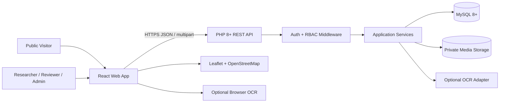

# System Architecture

## Virasat Atlas - React + PHP + MySQL

**Architecture style:** Modular monolith with a versioned REST API.  
**MVP deployment:** React static build + PHP application + MySQL database + private media storage.  
**Primary design principle:** Store cultural records with their context and provenance; make the same record discoverable through catalogue, map and collections.

---

## 1. Architecture overview



The browser communicates only with the PHP API for application data. React must never connect directly to MySQL. The PHP API owns authentication, validation, authorization, business rules, upload handling and audit logging. MySQL stores structured metadata and search indexes. Original media files are stored on disk outside the public web root for the prototype; the database stores a storage key and metadata, not the binary file itself.

## 2. Technology decisions

| Layer | Selected technology | Reason / constraint |
|---|---|---|
| Web UI | React.js + Vite | Fast development, reusable UI and static deployment |
| Routing | React Router | Clear public, researcher and review routes |
| Styling | CSS Modules or Tailwind CSS | Consistent design system; choose one and use consistently |
| HTTP | Fetch wrapper or Axios | Centralised API base URL, credentials and error handling |
| Backend | PHP 8.2+ | Required stack; simple REST endpoints and broad hosting support |
| DB access | PDO | Parameterised SQL and transaction support |
| Database | MySQL 8+ / InnoDB | Relational integrity, indexes, FULLTEXT and optional spatial indexing |
| Map | Leaflet + OpenStreetMap tiles | Lightweight map-first discovery without a paid map dependency |
| OCR assist | Optional Tesseract.js in browser or provider adapter | Keeps PHP + MySQL as the core backend; OCR is reviewable and non-blocking |
| Media | Local private storage for MVP | Simple deployment; can move to object storage later |

## 3. Application modules

### 3.1 React frontend

- `public`: Explore, search, item detail, map and collections.
- `auth`: sign-in, sign-out and current-user state.
- `workspace`: researcher drafts, contribution form and submission status.
- `review`: moderation queue, record review and OCR correction.
- `admin`: user/role and taxonomy administration.
- `shared`: navigation, cards, forms, map, upload widget, status badges and error states.

Suggested frontend structure:

```text
client/
  src/
    app/                # router, providers, route guards
    api/                # API client and endpoint functions
    components/         # shared UI components
    features/
      auth/
      archive/
      search/
      map/
      collections/
      workspace/
      review/
      admin/
    hooks/
    styles/
    utils/
```

### 3.2 PHP API

Use a modular monolith with small route/controller/service/repository boundaries. Avoid putting SQL and authorization checks directly in route files.

```text
server/
  public/index.php       # single API entry point
  src/
    Config/
    Middleware/         # auth, role, CSRF, request size
    Controllers/
    Services/           # archive, media, search, review, collections
    Repositories/       # PDO queries
    Validators/
    Responses/
    Utils/
  storage/              # private uploads; not web-accessible
  migrations/
```

Suggested request path: `Router -> Middleware -> Controller -> Validator -> Service -> Repository(PDO) -> MySQL`. Return a consistent JSON response and map exceptions to safe HTTP errors.

### 3.3 MySQL database

Core entities:

- `users`: account, password hash and role.
- `locations`: named place, administrative region and optional coordinates.
- `archive_items`: descriptive record, workflow state, visibility, provenance and location link.
- `media_assets`: stored file reference, MIME type, checksum, size, alt text and primary-image flag.
- `tags` + `archive_item_tags`: controlled tagging.
- `collections` + `collection_items`: ordered thematic/route groupings.
- `ocr_jobs`: original OCR output, language, engine, status and reviewed text.
- `audit_logs`: significant edits and moderation actions.

See `database/schema.sql` for the implementation baseline.

## 4. Core data flow

### 4.1 Contribution / upload flow

1. Researcher authenticates and receives a session.
2. React sends metadata as JSON and file bytes as `multipart/form-data` to the PHP API.
3. PHP checks session, CSRF token, role, size, extension, MIME type and file signature where practical.
4. PHP generates a random storage name; the original filename is retained only as display metadata.
5. File is stored outside the web root. A `media_assets` row is created with size, MIME, SHA-256 checksum and storage key.
6. An `archive_items` row and related tags are created in a transaction. If the item transaction fails, remove the orphaned file or enqueue cleanup.
7. Researcher saves draft or submits to review. An audit event records the action.

### 4.2 Discovery flow

1. React requests `/api/v1/archive-items` with `q`, filters, page and page size.
2. PHP validates and normalises query parameters.
3. Repository uses parameterised SQL, FULLTEXT search and appropriate indexes.
4. Only `status='published' AND visibility='public'` is returned to anonymous users.
5. Results include lightweight metadata and thumbnail URLs; full media is loaded on detail pages.

### 4.3 Map flow

1. React requests published records with valid coordinates from `/api/v1/locations` or the map-filter endpoint.
2. PHP returns coordinates, location label, item count and item IDs.
3. Leaflet displays markers and clusters where density requires it.
4. Selecting a marker opens a compact preview; clicking through opens the archive detail page.

### 4.4 OCR-assisted flow

1. User chooses a source language and starts OCR for a supported image/PDF page.
2. Browser OCR or an optional adapter returns extracted text and any available confidence estimate.
3. PHP stores the raw extraction in `ocr_jobs`; it does not overwrite the curated transcript.
4. Researcher/reviewer compares the output with the source and saves a reviewed transcript.
5. Search indexes the reviewed transcript, not an unverified extraction.

**Important:** do not claim an OCR engine supports a language until its language data has been installed and tested on representative material.

## 5. API design

Base path: `/api/v1`. JSON responses use UTF-8 and a predictable envelope:

```json
{
  "data": {},
  "meta": { "page": 1, "per_page": 20, "total": 0 },
  "error": null
}
```

Errors should use an HTTP status code and a safe message, for example:

```json
{
  "data": null,
  "error": { "code": "VALIDATION_ERROR", "message": "Please correct the highlighted fields.", "fields": { "title": "Title is required." } }
}
```

### Endpoint baseline

| Method | Endpoint | Access | Purpose |
|---|---|---|---|
| POST | `/auth/login` | Public | Start a session |
| POST | `/auth/logout` | Authenticated | End a session |
| GET | `/auth/me` | Authenticated | Current user and role |
| GET | `/archive-items` | Public / role-aware | Search and paginate discoverable records |
| POST | `/archive-items` | Researcher+ | Create a draft |
| GET | `/archive-items/{id}` | Public if published; owner/reviewer otherwise | View a record |
| PATCH | `/archive-items/{id}` | Owner/reviewer/admin | Update metadata |
| POST | `/archive-items/{id}/media` | Researcher+ | Attach one or more media files |
| DELETE | `/media/{id}` | Owner/reviewer/admin | Remove an attachment subject to audit |
| GET | `/locations` | Public | Map locations with public item counts |
| GET | `/collections` | Public | List published collections |
| POST | `/collections` | Reviewer/admin | Create collection |
| PATCH | `/collections/{id}/items` | Reviewer/admin | Set ordered membership |
| GET | `/review-queue` | Reviewer/admin | Pending submissions |
| POST | `/archive-items/{id}/review` | Reviewer/admin | Approve, reject or return for correction |
| POST | `/archive-items/{id}/ocr-jobs` | Researcher+ | Register an OCR run/result |
| PATCH | `/ocr-jobs/{id}` | Owner/reviewer | Save reviewed transcription |

### Search query parameters

`q`, `type`, `tag`, `region`, `location_id`, `language`, `period`, `collection_id`, `page`, `per_page`, `sort`. Enforce a maximum page size (for example 50), allowlist sort values and cap query length.

## 6. Authentication and authorisation

For a same-origin deployment, use PHP sessions with cookies configured as `HttpOnly`, `Secure` in HTTPS and `SameSite=Lax` or stricter as compatible. Protect state-changing requests with a CSRF token. If the frontend and API must be cross-origin, configure an exact CORS allowlist and credential policy; never combine wildcard origins with credentials.

Roles:

- `visitor`: public content only.
- `researcher`: create and edit own drafts; submit records.
- `reviewer`: inspect submissions, correct metadata and approve/reject.
- `admin`: manage users, roles, taxonomy and platform configuration.

The backend is authoritative. Hiding a button in React is not access control.

## 7. Security and data integrity

- Use `password_hash()` and `password_verify()`; never store plaintext passwords.
- Use PDO prepared statements for all user-controlled SQL values.
- Validate every field server-side, including enum values, IDs and coordinate ranges.
- Restrict allowed file types and file sizes; inspect MIME using `finfo`; use generated names; block executable files; store outside the public directory.
- Serve downloads through an authorised PHP route or short-lived signed storage path; set safe `Content-Disposition` and `X-Content-Type-Options: nosniff`.
- Escape user content on output; do not render archive HTML as trusted markup.
- Rate-limit login and public search where feasible; add upload quotas.
- Log important review and permission changes; never log passwords, session IDs or full private content.
- Back up MySQL and media together; a database backup without its referenced media is incomplete.
- Record copyright/licence and attribution information. Restrict visibility when permission is unknown.

## 8. Search and indexing strategy

MVP search uses MySQL `FULLTEXT` over title, summary, description and reviewed transcript. Add B-tree indexes for status, visibility, item type, region, language, creation date and foreign keys. Use a controlled tag join for facets. Use database-side filtering and pagination; do not load the entire archive into React.

A future semantic search service can add embeddings without changing the archive record model. Keep the `SearchService` interface independent from the current MySQL query implementation.

## 9. Scalability and deployment path

### Hackathon deployment

- React production build served by Nginx/Apache or static hosting.
- PHP-FPM/API hosted under the same domain or behind a reverse proxy.
- MySQL on a managed or local service with backups.
- Private local media directory with restrictive permissions.
- Environment secrets stored outside source control.

### Growth path

1. Move media to S3-compatible object storage and generate thumbnails asynchronously.
2. Add background jobs for OCR, PDF rendering, virus scanning and metadata extraction.
3. Add Redis for cache/rate limits only when measured bottlenecks justify it.
4. Add a dedicated geospatial/search index if MySQL query plans show a need.
5. Add vector search as a separate, replaceable service.
6. Add CDN delivery for public derivatives while preserving private originals.
7. Add backup verification, retention policies and institutional export formats.

## 10. Observability and operational checks

Record request ID, route, response status and duration. Track upload failures, search latency, review queue size, OCR error rate and broken media references. Keep logs structured and redact personal data. Provide a health endpoint that checks application readiness without exposing database credentials or internal configuration.

## 11. Architecture decisions (ADRs)

| ADR | Decision | Rationale | Revisit when |
|---|---|---|---|
| ADR-01 | React + PHP + MySQL core | Required stack and familiar deployment model | New scale or integration need |
| ADR-02 | Modular monolith, not microservices | Small team and short hackathon window | Independent scaling/ownership emerges |
| ADR-03 | MySQL FULLTEXT for MVP search | Avoid extra infrastructure and keep setup simple | Search relevance/multilingual needs exceed it |
| ADR-04 | Human-reviewed OCR | Protect research quality and avoid false certainty | Tested language-specific OCR pipeline is available |
| ADR-05 | Leaflet + OpenStreetMap | Low-friction map experience | Product requires advanced routing/licensed tiles |
| ADR-06 | Private media storage with database references | Separates large binary assets from relational data | Media volume or hosting requires object storage |

## 12. Architecture definition of done

- The React app uses only the PHP API for persistent data.
- API validation and role checks happen server-side.
- Public endpoints cannot expose drafts/private records.
- Uploads are stored outside the public root and are linked to records.
- Search, map and collection views operate on the same archive-item IDs.
- The schema is reproducible from versioned SQL migrations.
- Setup, configuration, seed data and deployment steps are documented.
